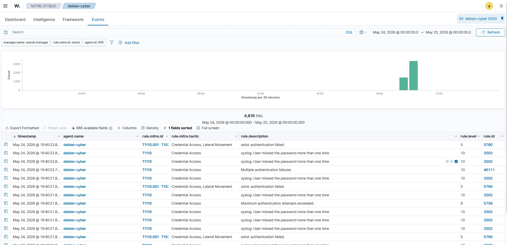
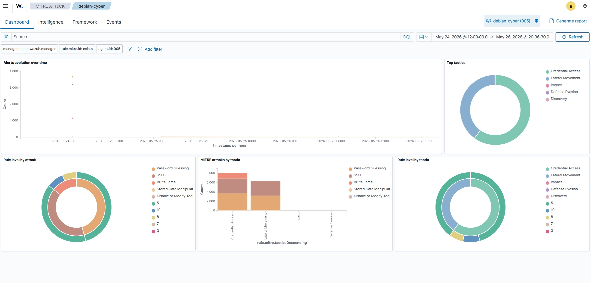
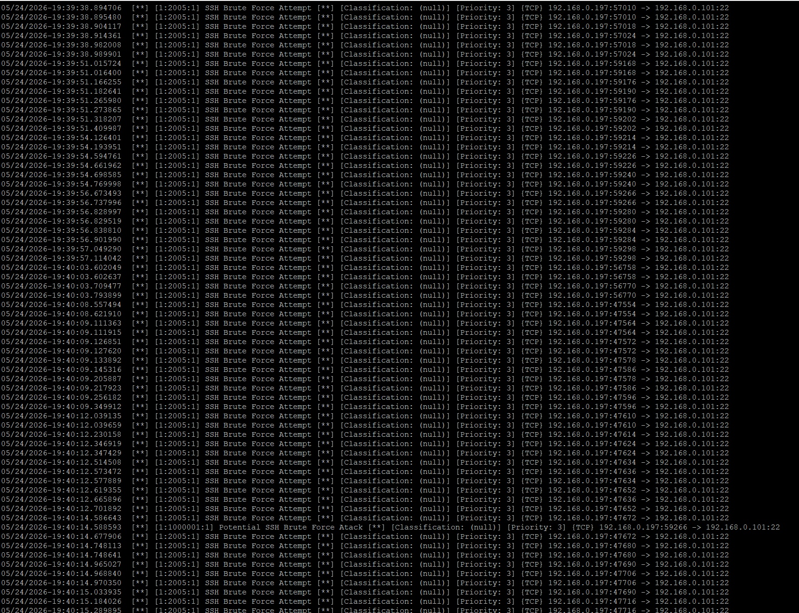
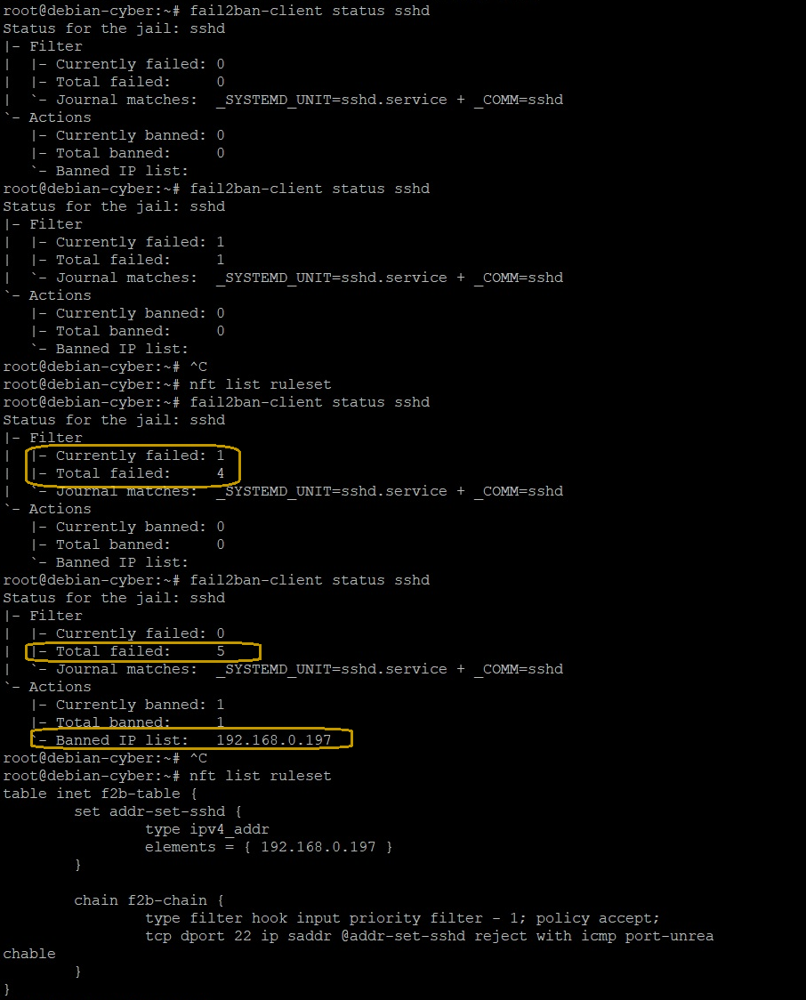
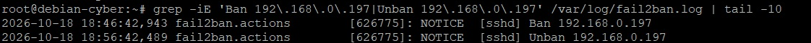
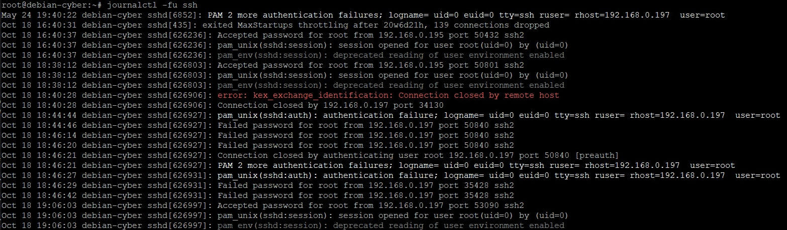

# Incident Report: SSH Brute-Force Attempt

## 1. Incident Overview

- **Incident type:** SSH brute-force attempt
- **Severity:** Medium (lab assessment)
- **Target:** Debian 12 server
- **Target IP:** `192.168.0.101`
- **Source IP:** `192.168.0.197` (Kali Linux)
- **Affected service:** SSH (TCP/22)
- **Automated response tool:** Fail2Ban
- **Firewall:** nftables
- **Status:** Resolved

## 2. Executive Summary

Repeated failed SSH authentication attempts were generated from a controlled Kali Linux test machine against a Debian server.

Fail2Ban detected five failed authentication attempts and automatically blocked the source IP address using nftables.

The block expired after approximately 10 minutes. After the ban expired, an SSH connection from Kali Linux to the Debian server was successfully established.

The test validated the detection, temporary blocking, automatic unblocking, and recovery stages of the response workflow.

## 3. Detection

The lab environment used multiple security tools to observe and analyze the simulated SSH brute-force activity.

### 3.1 Host-Based Detection — Wazuh

Wazuh collected SSH authentication events from the Debian system through the systemd journal.

During the test, the following alerts were observed:

- **Rule ID 5760:** `sshd: authentication failed.`
- **Rule ID 2502:** `syslog: User missed the password more than one time.`

Both alerts were associated with the same SSH authentication session and provided complementary information about the failed login activity.

### 3.2 Network-Based Detection — Suricata

Suricata monitored network traffic and generated an alert based on a custom SSH-related detection signature.

The alert indicated potentially suspicious SSH activity. Network alerts were treated as detection indicators and correlated with host-based authentication logs.

### 3.3 Automated Detection — Fail2Ban

Fail2Ban monitored SSH authentication events through the systemd journal.

The SSH jail used the following configuration:

- **Maximum failed attempts:** 5
- **Detection window:** 600 seconds
- **Ban duration:** 600 seconds
- **Log source:** systemd journal
- **Jail:** sshd

After the configured threshold was reached, Fail2Ban triggered an automatic IP block through nftables.

The Fail2Ban status confirmed five failed attempts and one ban.

## 4. Response and Containment

After the configured threshold was reached, Fail2Ban blocked the source IP address using nftables.

During the active ban, SSH traffic from the blocked address was rejected by the firewall rule managed by Fail2Ban.

The nftables ruleset confirmed that the source IP address was added to the Fail2Ban-managed address set.

## 5. Incident Timeline

| Time | Event |
|---|---|
| 18:46:42 | Fail2Ban blocked 192.168.0.197 |
| 18:56:42 | Fail2Ban automatically unblocked 192.168.0.197 |
| After unblocking | SSH connectivity from Kali Linux to Debian was successfully restored |

The timeline is based on the Fail2Ban logs collected during the test on October 18, 2026.

## 6. Evidence

### 6.1 Wazuh Evidence

The following screenshots show Wazuh alerts generated during the SSH brute-force simulation.

- Rule ID 5760: `sshd: authentication failed.`
- Rule ID 2502: `syslog: User missed the password more than one time.`

Both alerts originated from the same SSH authentication session.

### 6.2 Suricata Evidence

Suricata generated an alert based on a custom SSH-related detection signature during the test.

### 6.3 Fail2Ban and nftables Evidence

The screenshots demonstrate the detection of repeated SSH authentication failures and the resulting IP block enforced through nftables.

### 6.4 Automatic Unban and Recovery Evidence

The following screenshots demonstrate the automatic removal of the IP block after the configured ban duration and the subsequent restoration of SSH connectivity.

## 7. Recovery and Validation

After the automatic unban, a new SSH connection from Kali Linux to the Debian server was successfully established.

This confirmed that SSH connectivity was restored after the temporary block expired.

The recovery test completed the validation of the automated response workflow.

## 8. Root Cause and Assessment

The failed authentication attempts were intentionally generated as part of an authorized security test in a controlled home lab.

The experiment was designed to validate the detection and response mechanisms rather than investigate a real-world compromise.

The test demonstrated that Fail2Ban could detect repeated failed SSH authentication attempts and enforce a temporary IP block through nftables.

No successful unauthorized login was demonstrated by this test.

## 9. Recommendations

The following measures can further improve SSH security:

- Use SSH key-based authentication where appropriate.
- Disable password authentication when operationally feasible.
- Restrict SSH access to trusted networks where possible.
- Monitor SSH authentication events and review suspicious activity.
- Integrate host and network telemetry with Wazuh and Suricata.
- Review Fail2Ban events and investigate potential false positives.
- Retest the response mechanism after configuration changes.

## 10. Final Status

**Result: PASS**

The following capabilities were successfully validated:

- Detection of repeated failed SSH authentication attempts.
- Automatic blocking of the source IP through nftables.
- Automatic unblocking after the configured ban duration.
- Restoration of SSH connectivity after the ban expired.

This project demonstrates a basic automated incident response workflow in a controlled cybersecurity home lab using Fail2Ban and nftables.
