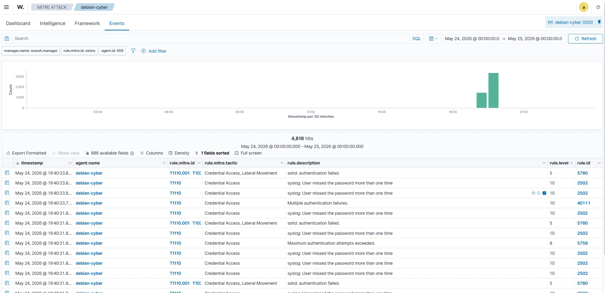
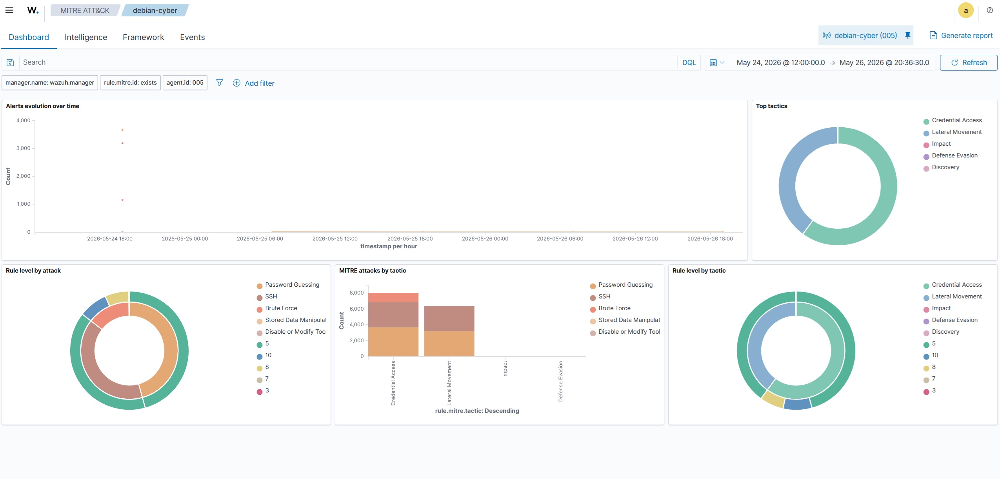
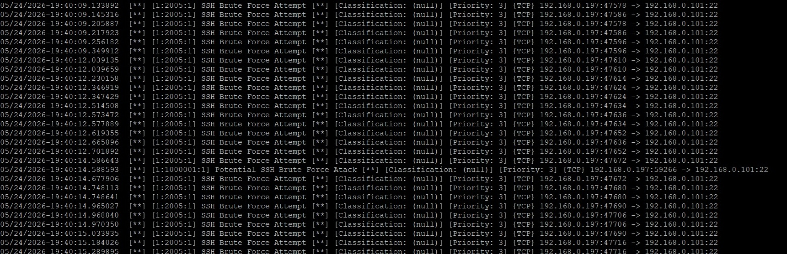
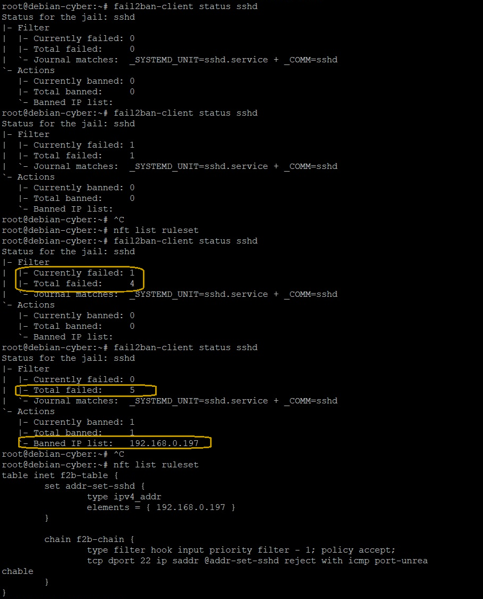
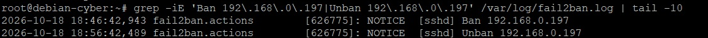
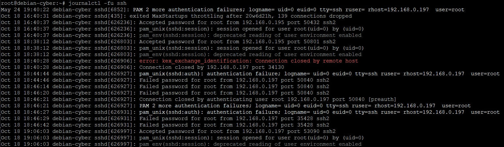

# SSH Brute Force Detection and Automated Response — Test Results

## 1. Objective

The objective was to validate the detection of repeated failed SSH authentication attempts, automated source IP blocking, automatic unblocking, and restoration of SSH connectivity.
The lab used three independent security components:

Wazuh — centralized collection and analysis of SSH authentication events.

Suricata — network traffic monitoring and alert generation based on a custom SSH detection signature.

Fail2Ban with nftables — automated temporary blocking of a source IP address after repeated failed SSH authentication attempts.

The test focused on validating the individual capabilities of these components and documenting their respective roles in the incident detection and response process.

## 2. Lab Environment

| Component               | Configuration    |
| ----------------------  | ---------------- |
| Target server           | Debian 12        |
| Test machine            | Kali Linux       |
| Target IP (Kali Linux)  | `192.168.0.101`  |
| Test source IP (Debian) | `192.168.0.197`  |
| Wazuh Manager           | `192.168.0.223`  |
| Wazuh Agent (Debian)    | `92.168.0.101`   |
| Suricata                | `7.0.10`         | 
| Wazuh Agent             | `4.13.1`         |
| Monitored service       | SSH, TCP port 22 |
| Detection and response  | Fail2Ban         |
| Firewall enforcement    | nftables         |
| Log source              | systemd journal  |

The Debian target server hosted the Wazuh Agent, Suricata, and Fail2Ban services.

The Wazuh Agent forwarded systemd journal events to the Wazuh Manager for centralized analysis.

The management host (192.168.0.195) was excluded from Fail2Ban blocking through the ignoreip configuration.

## 3. Detection and Response Configuration

### 3.1 Fail2Ban

Fail2Ban was configured to monitor SSH authentication events through the systemd journal.

The SSH jail used the following parameters:

| Parameter                |   Value                  |
| ------------------------ | -----------------------  |
| Jail                     | sshd                     |
| Backend                  | systemd                  |
| Failed-attempt threshold | 5                        |
| Detection window         | 600 swconds              |
| Ban duration (bantime)   | 600 seconds              |
| Firewall action          | nftables[type=multiport] |

The configuration used nftables to enforce temporary blocking of the source IP address.

### 3.2 Wazuh

The Wazuh Agent collected SSH authentication events from the Debian system journal and forwarded them to the Wazuh Manager.

The manager analyzed the events using its existing SSH and authentication-related rules.

Two relevant alerts were identified during the test:

| Rule ID      | Level      | Description                                          |  Significance                                                     |
| ------------ | ---------- | ---------------------------------------------------- | ----------------------------------------------------------------- |
| 5760         | 5          | sshd: authentication failed.                         | Detected a failed SSH password authentication event               |
| 2502         | 10         | syslog: User missed the password more than one time  | Detected a PAM message reporting repeated authentication failures |


Both alerts referenced the test source IP 192.168.0.197 and the target user root.

The alerts originated from the same SSH authentication session and were generated within approximately two milliseconds of each other.

Important: These alerts represent two related log events from the same SSH session. They should not be interpreted as two independent attack attempts.

The Wazuh alert timestamps were recorded in UTC.

### 3.3 Suricata

Suricata monitored network traffic on the Debian target server.

A custom signature was used to generate alerts for selected SSH traffic:

| Parameter                   | Value                           |
| --------------------------- | ------------------------------- |
| Alert description           | Potential SSH Brute Force Atack |
| Signature ID (SID)          | 1000001                         |
| Monitored destination port  | TCP 22                          |

The signature generated alerts for SSH traffic involving both the test machine (192.168.0.197) and the management host (192.168.0.195).

This demonstrates that the signature detected matching network traffic, but an alert alone does not confirm that the traffic represented a successful brute-force attack or repeated failed authentication attempts.

The alerts associated with the management host indicate that the custom signature may be too broad and can generate false positives.

## 4. Detection and Containment

Five failed SSH authentication attempts were generated from the authorized Kali Linux test machine (192.168.0.197) against the Debian target server.

### 4.1 Wazuh Detection Evidence

Wazuh successfully collected and analyzed SSH authentication events from the Debian target.

The following two alerts were identified:

Rule 5760 — SSH authentication failure

Rule ID: 5760

* Level: 5

* Source IP: 192.168.0.197

* Destination user: root

* Source port: 50840

* Log source: journald

* Event: Failed password for root

The alert confirmed that Wazuh detected a failed SSH password authentication event.

Rule 2502 — Repeated authentication failures

*  Rule ID: 2502

* Level: 10

* *ource IP: 192.168.0.197

* Destination user: root

* Log source: journald

Event: PAM 2 more authentication failures



This alert was generated after Wazuh received a PAM message reporting additional authentication failures during the same SSH session.

The two alerts demonstrate that Wazuh successfully collected and analyzed both an individual failed authentication event and a related PAM message indicating repeated failures.



### 4.2 Suricata Network Detection Evidence

Suricata generated alerts for SSH traffic between the test machine and the Debian target.

Relevant alerts included traffic from:

* 192.168.0.197:50840 to 192.168.0.101:22

* 192.168.0.197:53090 to 192.168.0.101:22

Additional alerts were generated for SSH traffic from the management host (192.168.0.195).

These results confirm that Suricata monitored the relevant SSH network traffic and generated alerts based on the configured custom signature.

However, because the same signature also alerted on management-host traffic, its detection precision requires further tuning and validation.



### 4.3 Fail2Ban Detection and Blocking

Fail2Ban independently monitored SSH authentication events through the systemd journal.

After five failed authentication attempts from 192.168.0.197, Fail2Ban detected the repeated failures and applied a temporary block.

* The Fail2Ban status reported:

* Total failed attempts: 5

* Total bans: 1

Currently banned: 1 during the active block

The nftables ruleset confirmed that the source IP was present in the Fail2Ban-managed address set.

The active firewall configuration included the f2b-table table and the addr-set-sshd address set.

This confirmed that the source IP was added to the firewall block list.

Note: Fail2Ban performed the blocking action based on its own SSH jail configuration. The test did not establish an integration in which Wazuh triggered Fail2Ban.



## 5. Automatic Unblocking

The Fail2Ban logs recorded the following events:

```text
2026-10-18 18:46:42 — Ban 192.168.0.197
2026-10-18 18:56:42 — Unban 192.168.0.197
```

The source IP was unblocked approximately 10 minutes after the ban was applied, consistent with the configured 600-second ban duration.

After the ban expired:

* Fail2Ban reported zero currently banned addresses.

* The corresponding nftables address set was empty.

* The temporary firewall restriction had been removed.

This confirmed that Fail2Ban automatically removed the temporary block after the configured ban period.



## 6. Recovery Validation

After the automatic unban, an SSH connection from Kali Linux (192.168.0.197) to the Debian server (192.168.0.101) was successfully established.

The Debian SSH journal recorded a successful authentication event:
```text
Accepted password for root from 192.168.0.197 port 53090 ssh2
```

This confirmed that SSH connectivity was restored after the temporary block expired.

The recovery test validated that the automated containment mechanism did not permanently prevent the authorized test machine from accessing the target server.




## 7. Timeline and Log Correlation
The test produced evidence in three independent security components.

| Event                                               | Component              | Recorded time     |
| --------------------------------------------------- | ---------------------- | ----------------- |
| Failed SSH authentication events                    | Debian systemd journal | 18:44–18:46 CEST  |
| SSH authentication failure alert (Rule 5760)        | Wazuh                  | 16:46:20 UTC      |
| Repeated authentication failures alert (Rule 2502)  | Wazuh                  | 16:46:21 UTC      |
| Source IP blocked                                   | Fail2Ban               | 18:46:42 CEST     |
| Source IP unblocked                                 | Fail2Ban               | 18:56:42 CEST     |
| SSH connectivity restored                           | Debian SSH journal     | 19:06:03 CEST     |

Time zone note: The Wazuh timestamps are displayed in UTC, while the Debian journal and Fail2Ban timestamps shown above use local time (CEST, UTC+2). The timestamps have been presented in their respective time zones and should be converted before comparing exact event times.

The logs provide evidence of related activity involving the same test source IP. However, the presence of alerts in multiple components does not by itself establish that one component triggered another.
## 8. Results

| Test                                                     | Result |
| -------------------------------------------------------- | ------ |
| Generate failed SSH authentication attempts              | PASS   |
| Collect SSH authentication events through journald       | PASS   |
| Detect failed SSH authentication in Wazuh                | PASS   |
| Detect repeated authentication failures in Wazuh         | PASS   |
| Generate Suricata alerts for matching SSH traffic        | PASS   |
| Detect repeated authentication failures with Fail2Ban    | PASS   |
| Block the source IP using nftables                       | PASS   |
| Confirm the active ban                                   | PASS   |
| Automatically remove the ban                             | PASS   |
| Restore SSH connectivity                                 | PASS   |

Observations and Limitations

* Wazuh successfully collected and analyzed SSH authentication events from the Debian target.

* Suricata generated alerts for matching SSH network traffic. The custom signature also generated alerts for management-host traffic, indicating a need for further tuning.

* Fail2Ban independently detected repeated SSH authentication failures and blocked the test source IP through nftables.

* Automatic unblocking worked as expected after the configured 600-second ban period.

* SSH connectivity was successfully restored after the ban expired.

* The test did not validate a direct integration in which Wazuh triggers Fail2Ban.

* The test was performed in a controlled home-lab environment. It does not establish production-scale effectiveness, detection accuracy across different attack patterns, or false-positive rates.
## 8. Conclusion

The test successfully demonstrated a basic SSH brute-force detection and automated response workflow using Wazuh, Suricata, Fail2Ban, and nftables.

Each component performed a distinct role:

* Wazuh collected and analyzed SSH authentication events, generating alerts for failed and repeated authentication failures.

* Suricata monitored SSH network traffic and generated alerts based on a custom detection signature.

* Fail2Ban independently detected repeated failed SSH authentication attempts and applied a temporary firewall block through nftables.

* nftables enforced the temporary source IP restriction and removed it after the configured ban period.

The final validation confirmed that SSH connectivity was restored after automatic unblocking.

The lab demonstrated the following security workflow:

Detection → Analysis → Automated Blocking → Temporary Containment → Automatic Unban → Connectivity Validation

The results provide practical evidence of log analysis, network monitoring, automated response, firewall enforcement, and incident validation in a controlled Linux environment.

Further improvements should focus on tuning the Suricata signature, reducing false positives, and exploring a documented integration between centralized alerting and automated response.

The results apply to the tested home-lab configuration and do not, by themselves, establish production-scale effectiveness or false-positive performance.
